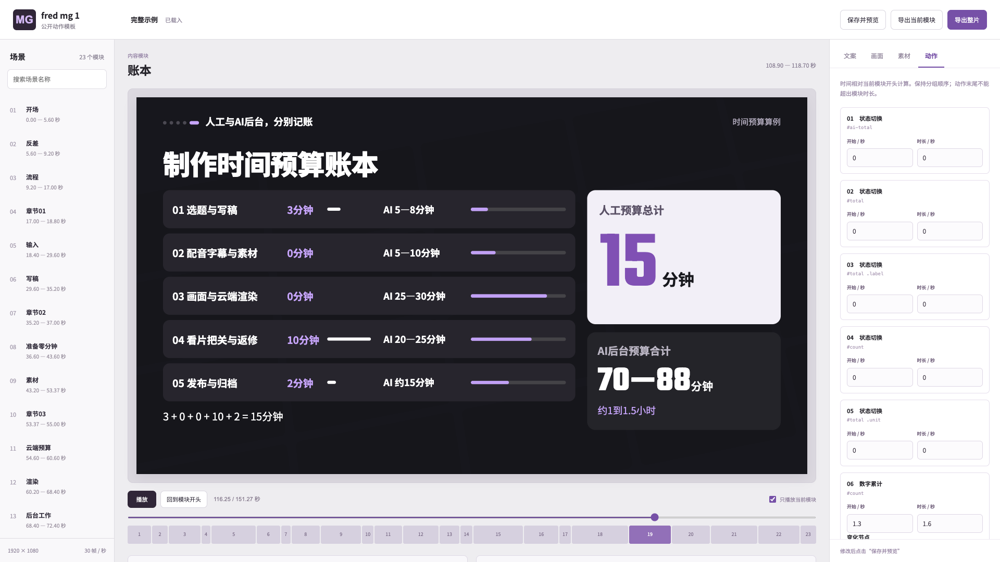

# fred mg 1

原视频抖音来源：[《FredTalk公开参考片》](https://www.douyin.com/video/7711624059825491263)。来源身份与权利边界见[风格元数据](风格.json)。

这是 mg style 集合中的一个独立风格，包含动作代码、场景模板、配置、媒体替换入口和本地编辑器。

本目录风格：**[fred mg 1](使用方式.md)**。黑白紫工作流风格，包含23个场景、五种章节结构，以及计数、划线、波形、分层反馈、独立进度重置等动作。

新增[23个独立组件](components/README.md)：[单组件预览](components/preview.html)、[参数目录](components/catalog.json)和独立构建入口。每个组件导出后只有自己的模板、动作与素材。

这是可运行的源码仓库。公开版附通用动态占位素材，没有个人配音、角色、封面、第三方录屏或原片左右对照；用你自己的内容替换即可。

## 快速开始

需要Python 3.10及以上版本。预览与编辑只需Python和浏览器；导出视频还需要Node.js、FFmpeg及已安装的Hyperframes Codex插件。

```sh
git clone https://github.com/ljhOfGithub/mg-style.git
cd mg-style
python3 -m venv .venv
source .venv/bin/activate
python -m pip install -r fred-mg-1/template/requirements.txt
python fred-mg-1/template/编辑器.py --port 8000
```

打开终端显示的本机编辑器地址，或在Chrome中访问 `http://127.0.0.1:8000/editor`。

左侧选场景，右侧修改文案、画面、素材与动作；保存后更新预览，可以导出当前模块或整片。变化节点支持增长、回落和再增长，不是只能从零拉满。

```sh
# 只构建HTML，不渲染视频
python fred-mg-1/template/命令.py build

# 检查与导出；需要已安装的Hyperframes启动器
python fred-mg-1/template/命令.py check
python fred-mg-1/template/命令.py render --name 我的演示
```

启动器不在默认位置时，可用 `--launcher /实际路径/plugin-cli.mjs` 指定。默认模板为1920×1080、30fps；示例时间线约151秒，按实际内容选场景与调整时长，不必每条视频都用完23场景。

## 编辑器预览



[开场](docs/opening.png) · [渲染面板](docs/rendering.png) · [四路并行](docs/parallel.png)

## 场景与动作

| 用途 | 模板能力 |
|---|---|
| 开场与引导 | 四行反向视频墙、整体拉远、标题显露、统计卡归位、计数与折线 |
| 输入与执行 | 单个位翻牌、白场带工作台入场、逐字输入、摘要与过程卡交叠 |
| 配音与素材 | 否定标签划线、波形着色、三卡错峰、连续媒体与首帧衔接 |
| 后台与排队 | 矩阵累积、六槽视频与独立进度、整环换分段、作品卡追加 |
| 审片与发布 | 非选中段降灰、修改意见、局部状态替换、双封面与完成标记 |
| 汇总与结尾 | 五行账本、连续计数、四路进度回落、长短条对比、逐字符归位 |

更多参数见[风格说明](skills/fred-mg-1/references/style-spec.md)与[模块索引](template/模块索引.json)。

## 在Codex中使用

本仓库附 [fred-mg-1 Skill](skills/fred-mg-1/SKILL.md)。将仓库中的 `fred-mg-1/skills/fred-mg-1` 复制到自己的Codex技能目录后，可登记仓库里的公开基线：

```sh
python fred-mg-1/skills/fred-mg-1/scripts/style.py register fred-mg-1
python fred-mg-1/skills/fred-mg-1/scripts/style.py verify
python fred-mg-1/skills/fred-mg-1/scripts/style.py init /新的项目目录
```

`init`拒绝覆盖已有目录。已经登记了自己的个人基线时，可以继续使用原登记，不必替换。

## 验证

```sh
python tools/verify_repository.py
python fred-mg-1/template/scripts/测试模板.py
python fred-mg-1/template/scripts/测试编辑器.py
python fred-mg-1/skills/fred-mg-1/scripts/test_style.py
node fred-mg-1/template/scripts/测试动作时序.js
node fred-mg-1/tools/test-preview-ready.js
```

[验证记录](docs/验证说明.md)区分源码检查、实际渲染与视觉抽查。成功构建不等于所有内容都适合当前主题。

## 来源与许可

风格由参考成片分析和通用骨架适配形成，不是原作者工程或逐像素副本。参考来源、依赖许可与素材范围见[来源与许可](NOTICE.md)。使用时分别遵守第三方许可；公开示例中的数值不代表个人实测。
